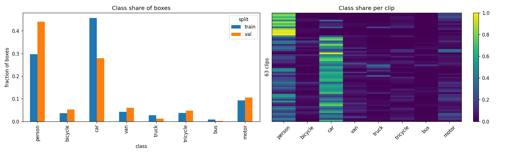
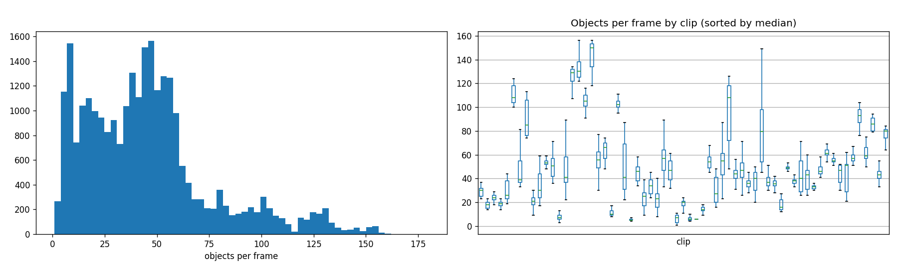
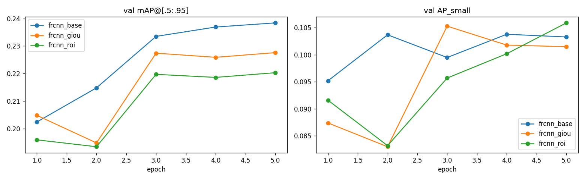
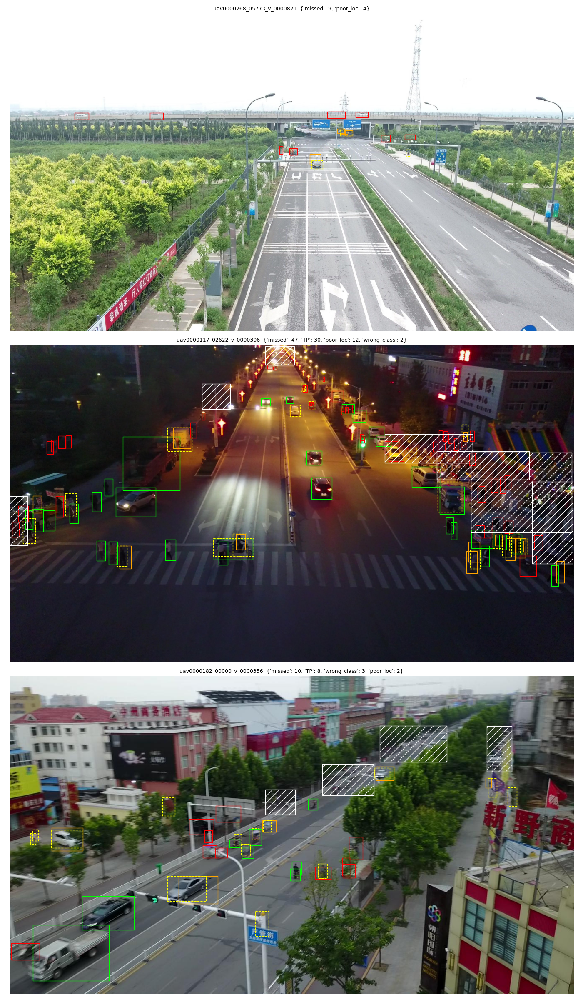
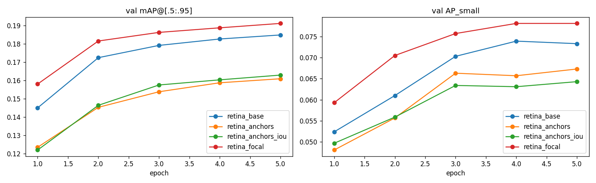
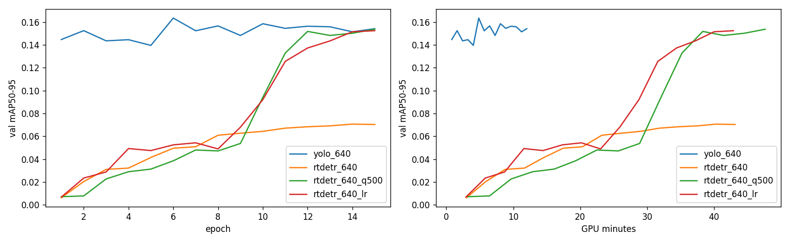

<!--
HOW TO USE THIS SKELETON (delete this block when done)
- Everything inside <!- - ... - -> comments is a writing prompt: it is invisible on the website.
  Replace each prompt with your OWN sentences (the course checks for AI-written text).
- Tables and figures below are filled with the real numbers from our runs; keep them, adjust if you like.
- Target: ~1500 words of text in total. Suggested words per section are in the prompts.
- Owner of each section: [P] Polina, [S] Sofia, [P+S] both.
-->

## 1. Task and summary
<!-- [P+S] ~80 words. Task in one sentence (8 classes, drone video, boxes per frame, COCO mAP).
Then the result in 2-3 sentences: which detector families you compared, which one was best alone,
and the final submission (WBF ensemble, val 0.271, public 0.2525; baseline 0.2216). -->

| final submission | val mAP@[.5:.95] | public LB |
|---|---|---|
| WBF ensemble: Faster R-CNN + YOLOv8 pipeline (07) | **0.271** | **0.2525** |
| Faster R-CNN alone (02b), second selected | 0.238 | 0.228 |
| Baseline (organisers) | – | 0.2216 |

## 2. Data understanding and preprocessing
<!-- [P] ~250 words. Rubric: class distribution, object sizes, objects per frame and how they vary
across sequences; which observations informed later choices; annotation conversion; ignored regions;
split by sequence; subsampling step justified; resize / normalisation / augmentation.

Facts from 01_eda (use what you need):
- train 56 clips / 24,201 frames / 1,105,516 boxes; val 7 clips / 2,846 frames / 114,132 boxes;
  test 48 clips / 3,811 frames. Resolutions vary from 680x382 to 3840x2160 (test has low-res clips).
- class shares (train): car 45.7 %, person 29.7 %, motor 9.3 %, van 4.2 %, tricycle 3.7 %,
  bicycle 3.6 %, truck 2.8 %, bus 0.9 % (bus appears in only 25 of 63 clips).
- object size (sqrt(w*h), original px): median 46, 5 % below 20; COCO buckets: 24 % small, 64 % medium, 12 % large.
  After resizing to short side 800 (what torchvision sees): median 32 px, 51 % < 32 px, 8.5 % < 16 px.
- objects per frame: median 42, 90th pct 90, max 180; 7.5 % of frames have > 100 objects.
  Median object size and density differ a lot between clips (see figures).
- ignored regions in 72 % of frames, usually small (median 1.6 % of the frame, max 38 %).
- neighbouring frames: mean grey-level difference 8.3 (1 frame apart) vs 19.5 (10 apart) -> justify step 10 / 5.
- conversion checked: our YOLO-txt box count equals the COCO json (1,105,516); GT drawn on frames (figure).
- choices that follow: high input resolution (800-1333 torchvision, 1024 YOLO), small anchors (k-means
  base 14 px, ratios 0.5/1.0/2.0, fitted on train only), maxDets 500, ignored regions masked in training and
  iscrowd=1 in evaluation, horizontal flip + brightness/contrast jitter (torchvision), Ultralytics defaults
  (mosaic, HSV, scale, flip) for YOLO/RT-DETR; ImageNet normalisation inside the models.
- validation: organisers' sequence-level split (56/7 clips), no clip shared. Say honestly why you used one
  fixed hold-out instead of k-fold GroupKFold (GPU budget), and that the same split + metric was used everywhere. -->

## 3. Two-stage anchor-based: Faster R-CNN
<!-- [P] ~250 words. Rubric: training setup, >= 2 two-stage parameters, mAP / AP50 / AP_small / speed,
what RPN and second stage contribute, >= 3 failure cases with plausible causes.
Setup: torchvision fasterrcnn_resnet50_fpn_v2, COCO-pretrained, new 9-class head, 5 epochs, SGD 0.01,
batch 4, warmup + cosine, AMP, best epoch by val mAP. Experiments: GIoU box loss (loss modification),
RoI sampling 256 RoIs with 50 % positives (hyperparameter), number of test-time RPN proposals. -->

| run | change | mAP | AP50 | AP75 | AP_small | ms/img | train min |
|---|---|---|---|---|---|---|---|
| frcnn_base | torchvision defaults | **0.238** | **0.476** | **0.207** | 0.103 | 240 | 37 |
| frcnn_giou | GIoU box loss | 0.228 | 0.455 | 0.198 | 0.102 | 240 | 37 |
| frcnn_roi | 256 RoIs, 50 % positives | 0.220 | 0.448 | 0.187 | **0.106** | 240 | 34 |

Test-time RPN proposals (frcnn_base, no retraining):

| proposals | 300 | 1000 | 2000 | 3000 |
|---|---|---|---|---|
| mAP | 0.237 | 0.238 | 0.239 | 0.236 |
| AR | 0.441 | 0.452 | 0.465 | 0.464 |
| ms/img | 205 | 240 | 291 | 343 |

What each stage contributes (class-agnostic recall, IoU ≥ 0.5 / ≥ 0.7):

| object size | RPN proposals | final detections |
|---|---|---|
| tiny < 16 px | 0.21 / 0.04 | 0.21 / 0.03 |
| small 16–32 | 0.66 / 0.35 | 0.59 / 0.27 |
| medium 32–96 | 0.82 / 0.61 | 0.76 / 0.50 |
| large > 96 | 0.99 / 0.95 | 0.97 / 0.87 |

<!-- Explain: the RPN decides which objects can be found at all (recall ceiling: tiny objects are lost already
here); the second stage classifies and refines boxes on RoI-aligned features. Why GIoU and RoI 50 % did not
beat the default in 5 epochs (AP_small of frcnn_roi is the best though). Proposals: 2000 gives +AR but small mAP gain
at +20 % time -> kept 1000.
Error breakdown at score 0.3: tiny GT 55 % missed, small 34 % missed, large only 6 %.
Class confusion: bus 75 % "wrong class", van 36 %, bicycle 33 % -> van vs car, bus vs truck, bicycle vs motor.
Per-clip mAP ranges 0.13 (uav0000268_05773_v) to 0.32 -> clip difficulty matters more than the model change.
Three failure cases (look at the figure and describe what you see + plausible cause):
1. uav0000268_05773_v frame 821: 0 TP, 9 missed, 4 poorly localised – far-away cars on a highway (tiny objects).
2. uav0000117_02622_v frame 306: night scene, 47 missed, 30 TP, 12 poor localisation – low light, dense, glare.
3. uav0000182_00000_v frame 356: 10 missed, 8 TP, 3 wrong class – occlusion by trees, oblique view. -->

## 4. One-stage anchor-based: RetinaNet
<!-- [P] ~200 words. Rubric: same protocol; tune anchors / focal loss / IoU thresholds; ground anchors in
EDA sizes; does removing the proposal stage cause problems and how to address them; compare initial and
tuned with the tuned two-stage model. -->

| run | change | mAP | AP50 | AP75 | AP_small | ms/img |
|---|---|---|---|---|---|---|
| retina_base | default anchors 32–512 px | 0.185 | 0.353 | 0.170 | 0.073 | 186 |
| retina_anchors | anchors from train k-means (14–356 px, ratios 0.5/1.0/2.0) | 0.161 | 0.356 | 0.124 | 0.067 | 186 |
| retina_anchors_iou | + positive/negative IoU 0.4 / 0.3 | 0.163 | 0.355 | 0.129 | 0.064 | 186 |
| retina_focal | base + focal γ = 1.5, α = 0.5 | **0.191** | **0.366** | **0.174** | **0.078** | 185 |
| *frcnn_base (tuned two-stage)* | | *0.238* | *0.476* | *0.207* | *0.103* | *240* |

<!-- Points to explain in your words:
- data-driven anchors: AP50 unchanged (0.353 -> 0.356) but AP75 dropped (0.170 -> 0.124) -> objects are found
  but boxes are worse; plausible cause: the pretrained regression head was trained for the default anchor scales,
  5 epochs are not enough to re-learn it. Unsuccessful experiment -> report it.
- focal loss with less down-weighting of easy examples helped slightly.
- no proposal stage: every anchor is classified directly -> extreme foreground/background imbalance and
  no second refinement; false positives: RetinaNet 13.2k vs Faster R-CNN 8.0k at score 0.3
  (wrong class 4.5k vs 2.5k). Remedies: focal loss, better positive assignment (ATSS), more epochs.
- recall by size (score 0.3): tiny 0.07 vs 0.12, small 0.41 vs 0.45, medium 0.59 vs 0.63, large 0.87 vs 0.83. -->

## 5. One-stage anchor-free: YOLOv8
<!-- [S] ~200 words. Rubric: tune >= 2 parameters (we did input resolution, P2 head, box-loss gain);
how locations are assigned without anchors (centre inside box + task-aligned top-k, TOOD) and the effect on
small/dense objects; search range; selected settings; comparison by object size with the anchor-based models.
Setup: Ultralytics YOLOv8s, COCO-pretrained, 15 epochs, batch 8, same frames, ignored regions masked. -->

| run | change | mAP | AP50 | AP_small | AP_medium | AP_large | ms/img | train min |
|---|---|---|---|---|---|---|---|---|
| yolo_640 | baseline 640 px | 0.146 | 0.281 | 0.073 | 0.119 | 0.297 | 10.5 | 12 |
| yolo_1024 | input 1024 px | 0.182 | 0.359 | 0.103 | 0.178 | 0.310 | 23.5 | 25 |
| yolo_1024_p2 | + P2 head (stride 4) | 0.182 | 0.366 | 0.104 | 0.167 | 0.340 | 36.6 | 45 |
| yolo_1024_box | 1024 + box-loss gain 7.5 → 10 | **0.190** | 0.363 | **0.108** | 0.175 | 0.326 | 23.7 | 25 |

Comparison of the tuned models by object size:

| model | AP_small | AP_medium | AP_large | mAP |
|---|---|---|---|---|
| Faster R-CNN (frcnn_base) | 0.103 | **0.221** | **0.426** | **0.238** |
| RetinaNet (retina_focal) | 0.078 | 0.169 | 0.360 | 0.191 |
| YOLOv8s (yolo_1024_box) | **0.108** | 0.175 | 0.326 | 0.190 |

<!-- Explain: resolution was the biggest lever (+0.036 mAP, AP_small +40 %); P2 head gave no mAP gain but
+AR and +AP_large at 1.5x time and its curve was still rising (new layers start from scratch);
box-loss gain helped slightly. Public LB of the 04 submission: 0.206.
Note on speed: Ultralytics ms/img includes pre/post-processing, torchvision times are model forward on a batch —
say they are measured differently. -->

## 6. Query-based: RT-DETR
<!-- [S] ~200 words. Rubric: same budget as a CNN; tune queries / matching / losses / lr; how bipartite matching
removes NMS and changes training; mAP-over-training plot vs CNN; small objects and dense scenes; state if not converged.
Setup: Ultralytics RT-DETR-L, COCO-pretrained, 640 px, 15 epochs, AdamW lr 1e-4 (same frames and image size as yolo_640). -->

| run | change | mAP | AP50 | AP_small | AP_large | AR | ms/img |
|---|---|---|---|---|---|---|---|
| rtdetr_640 | 300 queries | 0.079 | 0.151 | 0.035 | 0.190 | 0.306 | 47.0 |
| rtdetr_640_q500 | 500 queries | **0.159** | **0.300** | **0.061** | **0.317** | **0.386** | 50.7 |
| rtdetr_640_lr | lr 2e-4, 5 warmup epochs | 0.154 | 0.283 | 0.060 | 0.306 | 0.374 | 47.3 |
| *yolo_640 (same budget)* | | *0.146* | *0.281* | *0.073* | *0.297* | *0.250* | *10.5* |

<!-- Explain in your words:
- Hungarian matching gives each GT exactly one query -> duplicates are penalised in training -> no NMS;
  but only one positive per object -> weaker gradients early -> slow convergence.
- curves: RT-DETR starts near 0 and catches up with YOLO only around epoch 14; ~4x more GPU time than yolo_640;
  still rising at epoch 15 -> NOT converged within the budget (say this explicitly).
- 300 -> 500 queries doubled mAP, but EDA shows max 180 objects per frame, so 300 queries were never too few:
  the difference is NOT explained by scene density. Honest possible reasons: more queries = more candidates
  for top-k selection / more matching targets early in training, or run-to-run variance (only one seed).
- small objects: AP_small 0.061 vs YOLO 0.073 at 640 px. -->

## 7. Our pipeline
<!-- [S] ~250 words (+ [P] 100 words on the ensemble). Rubric: built on the comparisons; data / inference
strategies AND additional modelling, with intermediate comparisons that separate data/inference effects from
model effects; summary comparison of all models; temporal bonus.
Starting point: best YOLO config (yolo_1024_box). -->

**A. Data vs model change** (step-5 val, retrained):

| run | change | mAP | AP50 | AP_small |
|---|---|---|---|---|
| yolo_1024_box | reference | 0.190 | 0.363 | 0.108 |
| pipe_data_step3 | data: every 3rd frame instead of every 10th (3x data) | **0.204** | 0.379 | 0.101 |
| pipe_model_m | model: YOLOv8m instead of v8s, same data | 0.201 | **0.387** | 0.103 |

**B. Inference strategies** (same weights `pipe_data_step3`, **all** 2,846 val frames, so compare with pipe_base only):

| step | mAP | AP50 | AP_small | ms/img |
|---|---|---|---|---|
| pipe_base (1024 px) | 0.202 | 0.378 | 0.100 | 22 |
| test size 1280 | 0.212 | 0.399 | 0.102 | 36 |
| flip + scale TTA | 0.202 | 0.387 | 0.102 | 47 |
| 2x2 tiles + full image, NMS | 0.223 | 0.429 | 0.116 | 147 |
| tiles + temporal rescoring | **0.235** | **0.450** | **0.120** | +~0 |
| WBF of two YOLO models | 0.213 | 0.400 | 0.108 | – |

<!-- Temporal rescoring (bonus): link detections of consecutive frames (Hungarian on IoU, same class) into
tracks and blend each score with its track mean; grid of 18 settings on val, best iou 0.2, weight 0.7,
non-causal. Explain the idea in your words (cite Seq-NMS).
Unsuccessful / sobering: TTA gave nothing; the 06 submission scored only 0.200 public (below plain 04: 0.206)
although val said +0.033. Plausible reasons: temporal settings selected on the same 7 val clips (optimistic),
short test clips (~80 frames), low-resolution test videos where tiling mostly upsamples. -->

**C. Ensemble of two detector families (07, final):** Weighted Boxes Fusion of Faster R-CNN and the YOLO pipeline (tiles + temporal), step-5 val:

| run | mAP | AP50 | AP75 | AP_small |
|---|---|---|---|---|
| Faster R-CNN alone | 0.238 | 0.476 | 0.207 | 0.103 |
| YOLO pipeline alone | 0.236 | 0.450 | 0.214 | 0.120 |
| WBF, weights 1:1, IoU 0.5 | 0.265 | 0.512 | 0.239 | 0.127 |
| **WBF, weights 1:1, IoU 0.6** | **0.271** | **0.519** | **0.248** | **0.134** |
| WBF, weights 2:1, IoU 0.6 | 0.265 | 0.513 | 0.240 | 0.127 |
| WBF, weights 3:1, IoU 0.6 | 0.263 | 0.510 | 0.238 | 0.123 |

<!-- [P] Why it works: the two families make different errors (Faster R-CNN better on medium/large and AP50,
YOLO pipeline better on small objects); equal weights best. Here val and public agree (+0.024 public over
Faster R-CNN alone), unlike the 06 case. -->

**Summary of all detector families:**

| model (best run) | family | val mAP | AP_small | ms/img | public LB |
|---|---|---|---|---|---|
| Faster R-CNN R50-FPN v2 | two-stage | 0.238 | 0.103 | 240 | 0.228 |
| RetinaNet R50-FPN v2 | one-stage anchor | 0.191 | 0.078 | 185 | – |
| YOLOv8s 1024 | one-stage anchor-free | 0.190 | 0.108 | 24 | 0.206 |
| RT-DETR-L 640 | query-based | 0.159 | 0.061 | 51 | – |
| YOLOv8s, 3x data, tiles + temporal | pipeline | 0.236 | 0.120 | ~150 | 0.200 |
| **WBF(Faster R-CNN, YOLO pipeline)** | **ensemble** | **0.271** | **0.134** | – | **0.2525** |

## 8. Final model and how to run it
<!-- [S] ~100 words. Name the final submission (07 WBF ensemble) and the second selected one (02b).
How to reproduce: point to README "How to reproduce" (order 01 -> 02 -> 02b -> 03 -> 04 -> 05 -> 06 -> 07,
inputs, Kaggle T4, seed 42, requirements.txt). Mention the known issue in 06's last cell. -->

## 9. Conclusions
<!-- [P+S] ~100 words. Your own takeaways: e.g. resolution and small-object handling matter most on drone data;
two-stage was the strongest single model under a 5-epoch budget; DETR needs more training; val selection on few
clips can be optimistic; combining different families gave the most robust gain. What you would do with more GPU
time (longer training, all frames, larger models). -->

## References
<!-- Keep only what you used / cite in the text. -->
- Ren et al. *Faster R-CNN* (2015), arXiv:1506.01497; Lin et al. *Feature Pyramid Networks* (2017), arXiv:1612.03144
- Lin et al. *Focal Loss for Dense Object Detection (RetinaNet)* (2017), arXiv:1708.02002
- Redmon & Farhadi *YOLO9000* (k-means anchors) (2016), arXiv:1612.08242
- Feng et al. *TOOD: Task-aligned One-stage Object Detection* (2021), arXiv:2108.07755; Ultralytics YOLOv8, https://docs.ultralytics.com
- Zhao et al. *RT-DETR: DETRs Beat YOLOs on Real-time Object Detection* (2023), arXiv:2304.08069; Carion et al. *DETR* (2020), arXiv:2005.12872
- Rezatofighi et al. *Generalized IoU* (2019), arXiv:1902.09630
- Akyon et al. *SAHI: Slicing Aided Hyper Inference* (2022), arXiv:2202.06934
- Solovyev et al. *Weighted Boxes Fusion* (2019), arXiv:1910.13302; `ensemble-boxes` library
- Han et al. *Seq-NMS for Video Object Detection* (2016), arXiv:1602.08465
- Bolya et al. *TIDE* (2020), arXiv:2008.08115
- Zhu et al. *Detection and Tracking Meet Drones Challenge (VisDrone)* (2020), arXiv:2001.06303
- torchvision detection reference, https://docs.pytorch.org/vision/main/models.html
- Code was drafted with the help of an AI assistant (Claude) and checked/run by us; the report text is ours.
