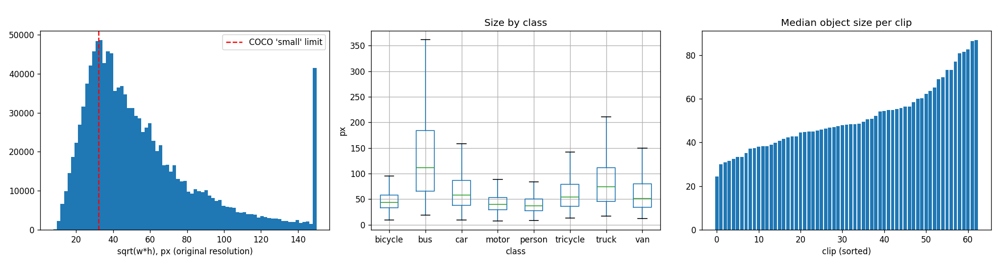
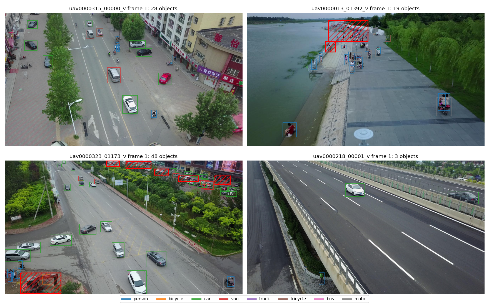
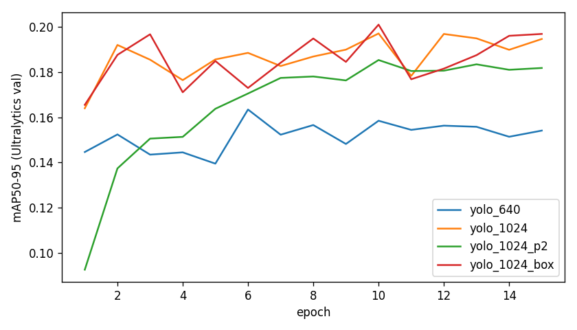

## 1. Task and summary

We detect eight object classes in VisDrone drone videos and are scored by COCO mAP@\[.5:.95\]. Our final submission is a Weighted Boxes Fusion (WBF) ensemble of a Faster R-CNN and a YOLOv8 pipeline with tiling and temporal rescoring. It reaches 0.271 on our validation set and 0.2525 on the public leaderboard, against a baseline of 0.2216.

| Submission | Val mAP | Public LB |
| --- | --- | --- |
| WBF ensemble, Faster R-CNN + YOLOv8 pipeline (07) | **0.271** | **0.2525** |
| Faster R-CNN alone (02b), second selected | 0.238 | 0.228 |
| Baseline (organisers) | — | 0.2216 |

We trained one detector from each required family under a fixed protocol: Faster R-CNN, RetinaNet, YOLOv8 and RT-DETR. The best one became the base of a final pipeline. That pipeline keeps changes to the data, the model and the inference separate, so the effect of each one is visible.

## 2. Data understanding and preprocessing

The dataset has 56 training clips (24,201 frames), 7 validation clips (2,846 frames) and 48 test clips (3,811 frames). Three properties of the data shaped almost every later decision.

**Imbalance.** Cars (45.7% of training boxes) and persons (29.7%) dominate. Bus is only 0.9% and appears in 25 of 63 clips. The class mix also changes strongly between clips (`class_distribution.png`).

**Small objects.** The median object is 46 px (√(w·h)) at original resolution. Detectors shrink the image so the short side is 800 px, and at that size the median is 32 px: 51% of objects fall below 32 px and 8.5% below 16 px (`object_sizes.png`). This motivated higher input resolutions, a stride-4 head, smaller anchors and tiled inference.

**Density and redundancy.** A frame has a median of 42 objects, with a maximum of 180 (`objects_per_frame.png`). We therefore allow 500 detections per image, which is also the Kaggle limit. Neighbouring frames are almost identical: the mean grey-level difference is 8.3 between frames t and t+1 and 19.5 between t and t+10. We train on every 10th frame (2,446 images) and validate on every 5th (571 images), which cuts GPU time tenfold while keeping most of the variety.

**Split.** We use the organisers' clip-level split, so no clip appears in both train and validation. Frames of one video are near-duplicates, so a frame-level split would leak information.

**Ignored regions.** These are unlabelled crowds, present in 72% of frames. In training we paint them with the mean colour of the image, so the model is not taught that they are background. In evaluation they become `iscrowd=1` boxes, copied for every class, so pycocotools neither rewards nor penalises detections inside them. We checked the conversion by drawing ground-truth boxes and ignored regions on sample frames (`gt_check.png`).

**Augmentation.** The torchvision models use horizontal flips and mild brightness and contrast jitter. The Ultralytics models use their default pipeline (mosaic, HSV, flips). The seed is 42 everywhere.

Test videos are lower-resolution than training (down to 680×382). This is one reason validation scores are higher than leaderboard scores.

## 3. Two-stage anchor-based: Faster R-CNN

**Setup.** We fine-tuned torchvision's COCO-pretrained Faster R-CNN R50-FPN v2 with a new 9-class head (8 classes plus background). Training ran 5 epochs with SGD (lr 0.01), batch 4, linear warmup then cosine decay, mixed precision, and the best epoch selected by val mAP.

| Run | Change | mAP | AP50 | AP75 | AP\_small | ms/img |
| --- | --- | --- | --- | --- | --- | --- |
| frcnn\_base | torchvision defaults | **0.238** | **0.476** | **0.207** | 0.103 | 240 |
| frcnn\_giou | GIoU box loss (weight 10) | 0.228 | 0.455 | 0.198 | 0.102 | 240 |
| frcnn\_roi | 256 RoIs, 50% positives | 0.220 | 0.448 | 0.187 | **0.106** | 240 |

Neither change beat the default within 5 epochs. GIoU replaces a loss the pretrained head was already tuned for, so it likely needs longer training. Sampling more positives per image (RoI 50%) gave the best AP\_small but more false positives overall. Varying test-time proposals (300 / 1000 / 2000 / 3000) moved mAP by at most 0.003 (0.237–0.239) while time grew from 205 to 343 ms, so we kept 1000.

**What each stage contributes.** We measured how many ground-truth objects are covered by an RPN proposal and by a final detection:

| Object size | RPN, IoU ≥ 0.5 / 0.7 | Final, IoU ≥ 0.5 / 0.7 |
| --- | --- | --- |
| tiny < 16 px | 0.21 / 0.04 | 0.21 / 0.03 |
| small 16–32 | 0.66 / 0.35 | 0.59 / 0.27 |
| medium 32–96 | 0.82 / 0.61 | 0.76 / 0.50 |
| large > 96 | 0.99 / 0.95 | 0.97 / 0.87 |

The RPN sets the recall ceiling: an object without a good proposal cannot be recovered later, and most tiny objects are already lost at this stage. The second stage classifies each proposal on RoI-aligned features and refines its box. It removes many candidates (recall drops slightly) in exchange for far fewer false positives.

**Failure cases** (`figures_frcnn_failures.png`, score ≥ 0.3):

1. **Distant small objects.** In uav0000268 (a highway seen from high altitude), frame 821 has 0 true positives, 9 missed objects and 4 poor boxes. The cars are only a few pixels wide after resizing. This is the clip with the lowest mAP (0.13; the other clips reach 0.20–0.32).
2. **Night and density.** In uav0000117, frame 306, a dark, crowded street gives 30 TP, 47 missed and 12 poor boxes. Low light and glare blur the object edges.
3. **Occlusion and confusable classes.** In uav0000182, frame 356, trees and an oblique view cause 10 missed and 3 wrong-class objects. Across the whole val set, 76% of buses are given the wrong class (as truck), 36% of vans (as car) and 33% of bicycles (as motor). These classes look alike from above, and bus has very few training examples.

## 4. One-stage anchor-based: RetinaNet

We trained torchvision's RetinaNet R50-FPN v2 under the same protocol as Faster R-CNN.

| Run | Change | mAP | AP50 | AP75 | AP\_small | ms/img |
| --- | --- | --- | --- | --- | --- | --- |
| retina\_base | default anchors 32–512 px | 0.185 | 0.353 | 0.170 | 0.073 | 186 |
| retina\_anchors | anchors from train k-means: 14–356 px, ratios 0.51/1.02/2.02 | 0.161 | 0.356 | 0.124 | 0.067 | 186 |
| retina\_anchors\_iou | + positive/negative IoU 0.4/0.3 | 0.163 | 0.355 | 0.129 | 0.064 | 186 |
| retina\_focal | base + focal γ 1.5, α 0.5 | **0.191** | **0.366** | **0.174** | **0.078** | 185 |

**Anchors grounded in the data were an unsuccessful experiment.** We set the smallest anchor to the 5th percentile of object size after resizing (14 px) and took aspect ratios from k-means on training boxes, following YOLOv2. Recall rose (AR 0.355 → 0.381) and AP50 stayed the same, but AP75 fell from 0.170 to 0.124: objects were found, but their boxes were less accurate. A plausible cause is that the pretrained regression head was learned for the default anchor scales, and 5 epochs were not enough to re-learn it. Lowering the IoU thresholds did not help. The focal-loss change, which down-weights easy examples less and positives more, gave the best RetinaNet.

**What is lost without a proposal stage.** RetinaNet classifies about 100k anchors directly, and almost all of them are background. Focal loss makes training possible, but there is no second stage to reject candidates and refine boxes. At score 0.3 it makes 13.2k false positives against Faster R-CNN's 8.0k, including 4.5k wrong-class detections (2.5k for Faster R-CNN) and 598 duplicates (108). Its detection rate is lower for tiny objects (0.07 vs 0.12) and small ones (0.41 vs 0.45), but higher for large ones (0.87 vs 0.83). Possible fixes are better positive assignment (ATSS), longer training, or a refinement head. Overall it is 0.047 mAP below the tuned Faster R-CNN and 23% faster.

## 5. One-stage anchor-free: YOLOv8

We fine-tuned Ultralytics YOLOv8s (COCO-pretrained) for 15 epochs with batch 8 on the same frames, with ignored regions masked. The search covered input size {640, 1024}, a P2 head {off, on} and the box-loss gain {7.5, 10}.

| Run | Change | mAP | AP50 | AP\_small | AP\_medium | AP\_large | ms/img |
| --- | --- | --- | --- | --- | --- | --- | --- |
| yolo\_640 | baseline, 640 px | 0.146 | 0.281 | 0.073 | 0.119 | 0.297 | 10.5 |
| yolo\_1024 | input 1024 px | 0.182 | 0.359 | 0.103 | 0.178 | 0.310 | 23.5 |
| yolo\_1024\_p2 | + P2 head (stride 4) | 0.182 | 0.366 | 0.104 | 0.167 | 0.340 | 36.6 |
| yolo\_1024\_box | 1024 + box gain 10 | **0.190** | 0.363 | **0.108** | 0.175 | 0.326 | 23.7 |

**Assignment without anchors.** Each feature-map location predicts class scores and the distances to the four box edges. Only locations whose centre lies inside a ground-truth box are candidates. The task-aligned assigner from TOOD then keeps the top-k candidates per object, ranked by classification score × IoU, as positives. For a tiny object, only a handful of locations at stride 8 fall inside it, so it gets very few positives. Raising the input to 1024 px gives each object more locations. In dense scenes, neighbouring objects compete for the same locations, which a stride-4 (P2) head should relieve.

**Results.** Resolution was the main lever: +0.036 mAP and +40% AP\_small. Recall on small objects (score ≥ 0.25) rose from 0.31 to 0.39. The P2 head added recall and AP\_large but no mAP, at 1.5× the inference time; its new layers start from scratch and were still improving at epoch 15. A higher box-loss gain helped slightly, so we selected 1024 px with box gain 10.

| Tuned model | AP\_small | AP\_medium | AP\_large | mAP |
| --- | --- | --- | --- | --- |
| Faster R-CNN | 0.103 | **0.221** | **0.426** | **0.238** |
| RetinaNet | 0.078 | 0.169 | 0.360 | 0.191 |
| YOLOv8s | **0.108** | 0.175 | 0.326 | 0.190 |

YOLOv8s matches RetinaNet's mAP and is the best on small objects, while being about 10× faster. The two speeds are not measured identically: Ultralytics times include pre- and post-processing, torchvision times are batched forward passes. Its public leaderboard score is 0.206.

## 6. Query-based: RT-DETR

We trained Ultralytics RT-DETR-L (COCO-pretrained) on the same budget as yolo\_640: the same frames, 640 px, 15 epochs, batch 8, with AdamW at lr 1e-4 and a cosine schedule.

| Run | Change | mAP | AP50 | AP\_small | AP\_large | AR | ms/img |
| --- | --- | --- | --- | --- | --- | --- | --- |
| rtdetr\_640 | 300 queries | 0.079 | 0.151 | 0.035 | 0.190 | 0.306 | 47 |
| rtdetr\_640\_q500 | 500 queries | **0.159** | **0.300** | **0.061** | **0.317** | **0.386** | 51 |
| rtdetr\_640\_lr | lr 2e-4, 5 warmup epochs | 0.154 | 0.283 | 0.060 | 0.306 | 0.374 | 47 |
| *yolo\_640, same budget* |  | *0.146* | *0.281* | *0.073* | *0.297* | *0.250* | *10.5* |

**Why no NMS.** RT-DETR outputs a fixed set of query predictions. In training, the Hungarian algorithm matches each ground-truth box to exactly one query, using a cost that combines class, L1 and GIoU terms, and every other query is trained to predict "no object". A second box on the same object is therefore penalised during training, so duplicates do not need to be removed afterwards. The cost is that each object has only one positive query, which gives a weak learning signal early on and slow convergence.

**Training behaviour.** In `figures_detr_vs_yolo.png`, RT-DETR's val mAP starts near zero and is still rising at epoch 15, while YOLO levels off after about five epochs. **RT-DETR has not converged within this budget.** Even so, the 500-query model beats yolo\_640 on mAP (0.159 vs 0.146), on recall for small objects (0.53 vs 0.31) and in dense frames (51–150 objects: 0.173 vs 0.154). Its AP\_small is lower (0.061 vs 0.073) and it is about 5× slower.

**Queries.** Going from 300 to 500 queries doubled mAP. Scene density does not explain this, since no frame has more than 180 objects. The LR-plus-warmup run with 300 queries also reached 0.154, so the 300-query base most likely suffered from a slow start in this particular run. With a single seed we cannot separate the two effects.

## 7. Our pipeline

We started from the best YOLO configuration (1024 px, box gain 10) because it was strongest on small objects and cheap enough to retrain. We changed one thing at a time.

**A. Data vs model** (step-5 val, retrained):

| Run | Change | mAP | AP50 | AP\_small |
| --- | --- | --- | --- | --- |
| yolo\_1024\_box | reference | 0.190 | 0.363 | 0.108 |
| pipe\_data\_step3 | data: every 3rd frame (3× images) | **0.204** | 0.379 | 0.101 |
| pipe\_model\_m | model: YOLOv8m, same data | 0.201 | **0.387** | 0.103 |

Three times more frames helped as much as a model twice the size, without the extra inference cost (23 vs 52 ms/img), so we kept YOLOv8s trained on more data.

**B. Inference strategies** (same weights, all 2,846 val frames, because temporal methods need consecutive frames):

| Strategy | mAP | AP50 | AP\_small | ms/img |
| --- | --- | --- | --- | --- |
| single pass, 1024 px | 0.202 | 0.378 | 0.100 | 22 |
| test size 1280 | 0.212 | 0.399 | 0.102 | 36 |
| flip + scale TTA | 0.202 | 0.387 | 0.102 | 47 |
| full image + 2×2 tiles (20% overlap), NMS | 0.223 | 0.429 | 0.116 | 147 |
| tiles + temporal rescoring | **0.235** | **0.450** | **0.120** | +≈0 |
| WBF of two YOLO models | 0.213 | 0.400 | 0.108 | — |

Tiling, as in SAHI, gives small objects more pixels and was the largest inference gain. TTA brought nothing.

**Temporal rescoring (bonus).** In each clip we link detections in consecutive frames into tracks, using the Hungarian algorithm on IoU and matching only the same class. Each detection's score is then blended with the mean score of its track: new = 0.3 · own + 0.7 · track mean. Objects seen consistently are boosted and one-frame flickers are pushed down, an idea similar to Seq-NMS. A grid of 18 settings chose IoU 0.2, weight 0.7 and the non-causal version. It improved 6 of 7 val clips.

**An honest setback.** The tiles + temporal submission scored only 0.200 on the public leaderboard, below plain YOLO (0.206), even though val promised +0.033. We see three plausible reasons. The temporal settings were selected on the same 7 val clips, so the gain is optimistic. Test clips are short (about 80 frames on average). And test videos are low-resolution, so tiling mostly upsamples blurry pixels.

**C. Ensemble of two families (final).** Weighted Boxes Fusion averages overlapping boxes from Faster R-CNN and the YOLO pipeline instead of discarding them.

| Run (step-5 val) | mAP | AP50 | AP75 | AP\_small |
| --- | --- | --- | --- | --- |
| Faster R-CNN alone | 0.238 | 0.476 | 0.207 | 0.103 |
| YOLO pipeline alone | 0.236 | 0.450 | 0.214 | 0.120 |
| WBF 1:1, IoU 0.5 | 0.265 | 0.512 | 0.239 | 0.127 |
| **WBF 1:1, IoU 0.6** | **0.271** | **0.519** | **0.248** | **0.134** |
| WBF 2:1 / 3:1, IoU 0.6 | 0.265 / 0.263 |  |  |  |

The two models make different errors. Faster R-CNN is better on medium and large objects, the YOLO pipeline on small ones, so fusing them improves every size bucket. Equal weights worked best. Here val and public agree: the ensemble beats Faster R-CNN alone by 0.024 on the public board (0.2525 vs 0.228).

| Model (best run) | Family | Val mAP | AP\_small | ms/img | Public LB |
| --- | --- | --- | --- | --- | --- |
| Faster R-CNN R50-FPN v2 | two-stage | 0.238 | 0.103 | 240 | 0.228 |
| RetinaNet R50-FPN v2 | one-stage, anchor | 0.191 | 0.078 | 185 | — |
| YOLOv8s 1024 | one-stage, anchor-free | 0.190 | 0.108 | 24 | 0.206 |
| RT-DETR-L 640 | query-based | 0.159 | 0.061 | 51 | — |
| YOLOv8s, 3× data, tiles + temporal | pipeline | 0.236 | 0.120 | ≈150 | 0.200 |
| **WBF(Faster R-CNN, YOLO pipeline)** | **ensemble** | **0.271** | **0.134** | — | **0.2525** |

## 8. Final model and how to run it

The final submission is the 07 WBF ensemble: Faster R-CNN plus the YOLO pipeline, weights 1:1, IoU 0.6 (val 0.271, public 0.2525). The second selected submission is Faster R-CNN alone, from 02b (public 0.228).

To reproduce, run the notebooks on Kaggle (GPU T4, Internet on) in this order:

1. 01 EDA (CPU)
2. 02 Faster R-CNN
3. 02b test predictions
4. 03 RetinaNet
5. 04 YOLO
6. 05 RT-DETR
7. 06 pipeline
8. 07 ensemble (CPU)

Each notebook's first cell clones the repository and installs `requirements.txt` (Ultralytics 8.4.192, pycocotools, ensemble-boxes 1.0.10). Later notebooks take earlier outputs as inputs; the README lists them with measured GPU times. The seed is 42 everywhere. To regenerate only the final `submission.csv`, run 07 with the outputs of 02, 02b and 06 attached.

**Known issue:** the last cell of 06 failed because `sample_submission.csv` is not mounted on Kaggle. All outputs, including `submission.csv`, had already been written. The corrected check, which compares against `test_images.csv`, is in 07.

## 9. Conclusions

On drone footage, how a method deals with small objects mattered more than which detector family it belonged to: input resolution, tiling and more training frames each gave more than any loss or anchor tweak. Under a 5-epoch budget the two-stage Faster R-CNN was the strongest single model. Our data-driven anchors and the GIoU loss did not help within the budget. RT-DETR needed more training than we could give it. Tuning on only 7 validation clips was optimistic for the temporal rescoring, which did not carry over to the leaderboard. Combining two families with different errors gave the most reliable gain on both validation and test.

With more GPU time we would train longer on all frames, try Cascade R-CNN and larger YOLO models with tiled training, and tune temporal settings with clip-level cross-validation.

## References

- Ren et al., *Faster R-CNN* (2015), arXiv:1506.01497 · Lin et al., *Feature Pyramid Networks* (2017), arXiv:1612.03144
- Lin et al., *Focal Loss for Dense Object Detection* (2017), arXiv:1708.02002
- Redmon & Farhadi, *YOLO9000* (2016), arXiv:1612.08242
- Feng et al., *TOOD* (2021), arXiv:2108.07755 · Ultralytics YOLOv8, docs.ultralytics.com
- Zhao et al., *RT-DETR* (2023), arXiv:2304.08069 · Carion et al., *DETR* (2020), arXiv:2005.12872
- Rezatofighi et al., *Generalized IoU* (2019), arXiv:1902.09630
- Akyon et al., *SAHI* (2022), arXiv:2202.06934
- Solovyev et al., *Weighted Boxes Fusion* (2019), arXiv:1910.13302
- Han et al., *Seq-NMS* (2016), arXiv:1602.08465
- Code was drafted with the help of an AI assistant (Claude) and checked/run by us; the report text is ours.
